# Previsão do tempo

Atividade 2 – Previsão do tempo · Programação para Dispositivos Móveis I – Prof. Arley · Fatec

Aplicativo Flutter para consultar a previsão do tempo de cidades brasileiras com os dados
do [CPTEC/INPE](https://servicos.cptec.inpe.br/XML/). O usuário pesquisa uma cidade, vê a
previsão de quatro dias com gráfico de temperatura e pode salvar as cidades que acompanha.

## Integrante

- Felipe Ferreira Pacheco

## Sumário

- [Funcionalidades](#funcionalidades)
- [Capturas de tela](#capturas-de-tela)
- [Como executar](#como-executar)
- [Bibliotecas utilizadas](#bibliotecas-utilizadas)
- [Persistência local](#persistência-local)
- [Serviço do CPTEC/INPE](#serviço-do-cptecinpe)
- [Estrutura do projeto](#estrutura-do-projeto)
- [Testes](#testes)
- [Decisões de projeto](#decisões-de-projeto)
- [Processo de desenvolvimento](#processo-de-desenvolvimento)

Detalhes de arquitetura, fluxo de dados e tratamento de erros estão em
[docs/arquitetura.md](docs/arquitetura.md).

## Funcionalidades

| Requisito da atividade | Como foi atendido |
| --- | --- |
| Pesquisa de cidades | A busca consulta `listaCidades?city=` enquanto o usuário digita (pausa de 400 ms, mínimo de 3 letras) ou ao confirmar no teclado. Cada resultado mostra o nome e a UF. |
| Código da localidade | A previsão é consultada com o `id` devolvido pela própria busca. |
| Previsão de 4 dias | Todos os dias retornados por `cidade/{codigo}/previsao.xml` são exibidos. |
| Dados de cada dia | Data, mínima e máxima em °C, descrição da condição, ícone da condição e índice ultravioleta (IUV) com a faixa de risco quando o serviço informa. |
| Data de atualização | Exibida no topo da previsão ("Atualizada pelo CPTEC/INPE em 15/11/2026"). |
| Siglas das condições | As 40 siglas da documentação oficial foram convertidas em descrições legíveis, com as abreviações escritas por extenso ("Poss. de Panc. de Chuva a Tarde" → "Possibilidade de pancadas de chuva à tarde"). |
| Gráfico | Linhas de máxima e mínima ao longo dos dias, com valores ao tocar. |
| Atualizar a previsão | Botão na barra superior e gesto de puxar para atualizar. |
| Indicador de carregamento | Indicador circular na primeira consulta, barra linear nas atualizações e na busca. |
| Nenhuma cidade encontrada | Mensagem específica com o termo pesquisado. |
| Falhas de conexão, serviço indisponível e respostas inválidas | Cada caso tem mensagem própria e opção de tentar novamente. Se já houver previsão salva, ela é exibida com um aviso. |
| Previsão indisponível | Mensagem própria quando o serviço não retorna dias para a localidade. |
| Campos ausentes | Valores ausentes ou `"null"` aparecem como "—" ou "não informado", sem encerrar o app. |
| Fonte dos dados | "Dados: CPTEC/INPE" em todas as telas com informações do serviço. |
| Persistência local | Cidades salvas e últimas previsões ficam no aparelho ([detalhes](#persistência-local)). |
| Navegação entre telas | Tela inicial → busca → previsão, com `Navigator`. |

Além do pedido, o app tem tema claro e escuro (segue o sistema) e layout em duas colunas em
telas largas, como tablets ou celulares na horizontal.

## Capturas de tela

As capturas abaixo são das telas reais do app, renderizadas a partir de respostas do
CPTEC/INPE gravadas em 15/11/2026 ([como são geradas](#capturas-de-tela-1)).

### Fluxo principal

| 1. Início sem cidades | 2. Busca | 3. Previsão | 4. Previsão – dias |
| :---: | :---: | :---: | :---: |
| 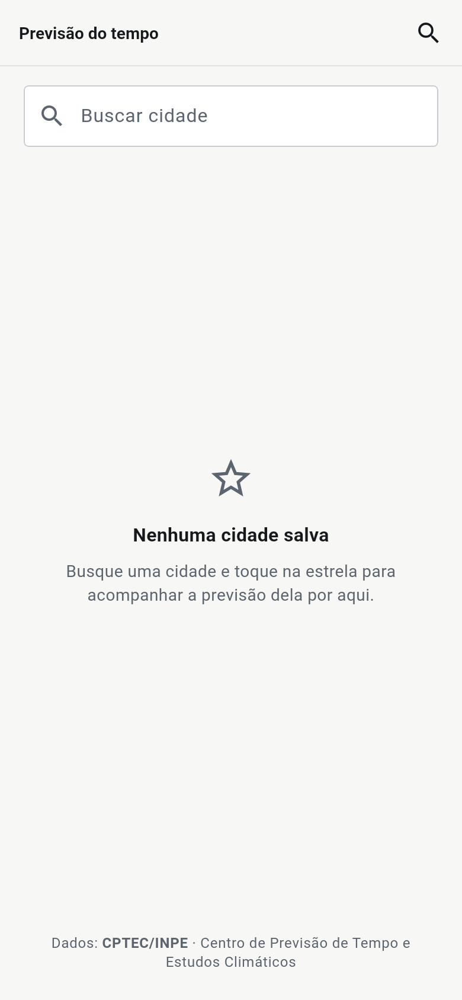 | 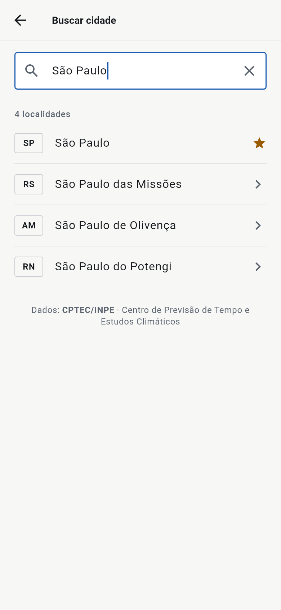 | 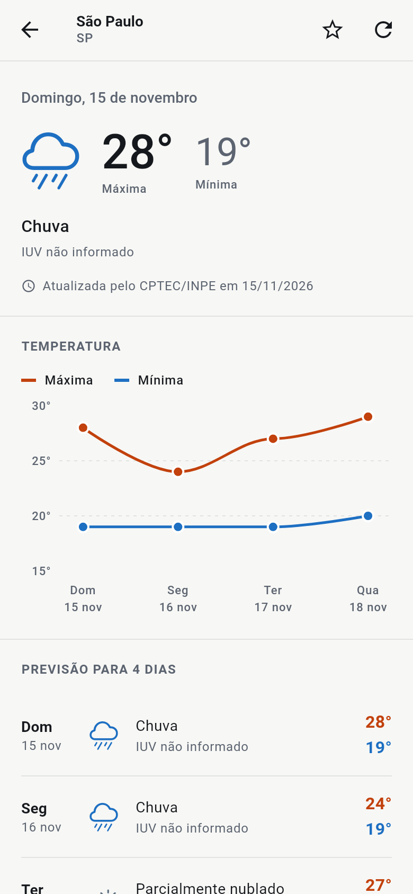 | 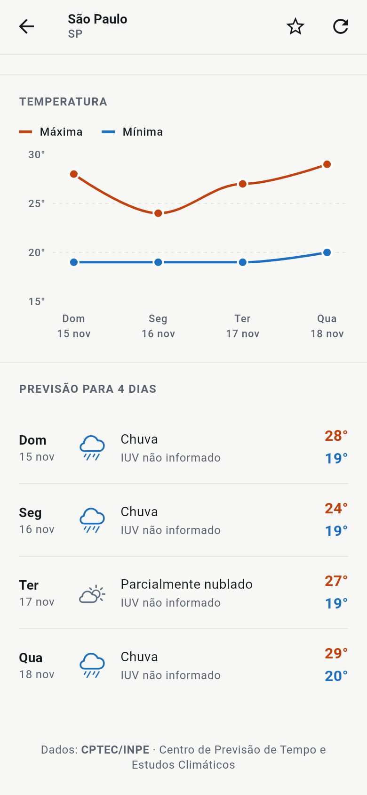 |
| Ponto de partida, com acesso à busca e identificação da fonte. | Resultados com nome e UF; a estrela indica cidade já salva. | Destaque do primeiro dia, data de atualização e gráfico de temperatura. | Os quatro dias com condição, IUV, máxima e mínima. |

| 5. Cidades salvas |
| :---: |
| 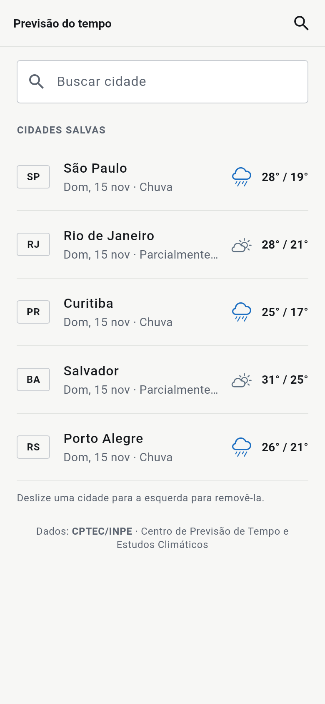 |
| Resumo da última previsão guardada de cada cidade. Deslizar remove, com opção de desfazer. |

### Estados e tratamento de erros

| 6. Nenhuma cidade encontrada | 7. Carregando | 8. Sem conexão, com previsão salva |
| :---: | :---: | :---: |
| 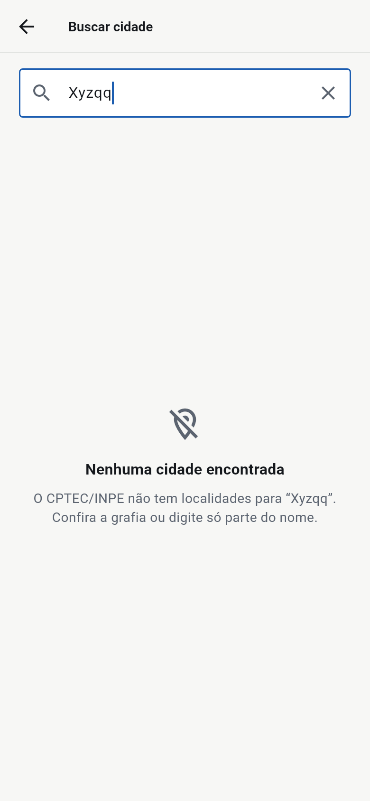 | 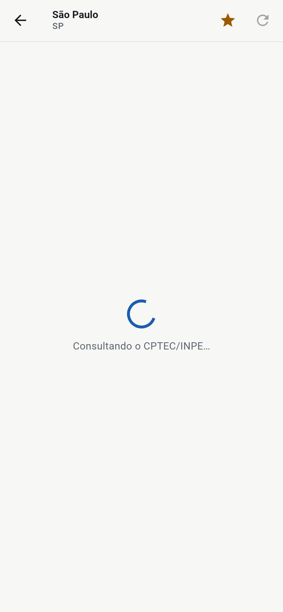 | 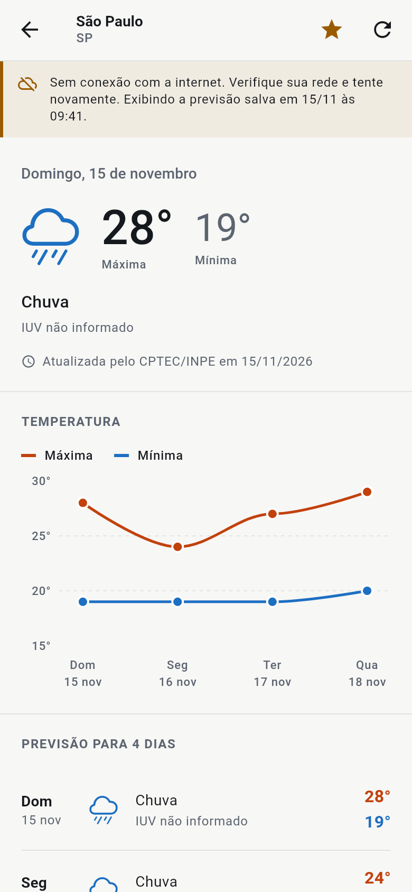 |
| Mensagem com o termo pesquisado. | Indicador durante a consulta ao serviço. | A previsão guardada é exibida com aviso e horário em que foi salva. |

| 9. Sem conexão, sem previsão salva | 10. Previsão indisponível |
| :---: | :---: |
| 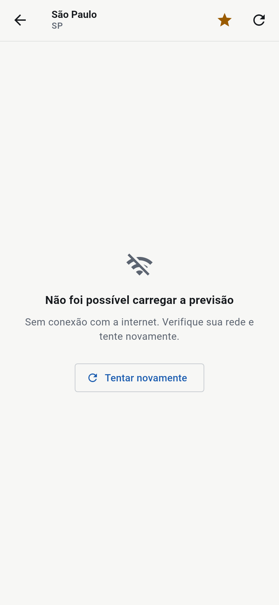 |  |
| Mensagem da falha e ação para tentar novamente. | Localidade sem dias de previsão (situação simulada na captura). |

### Tema escuro e tela larga

| 12. Início no tema escuro | 13. Previsão no tema escuro |
| :---: | :---: |
| 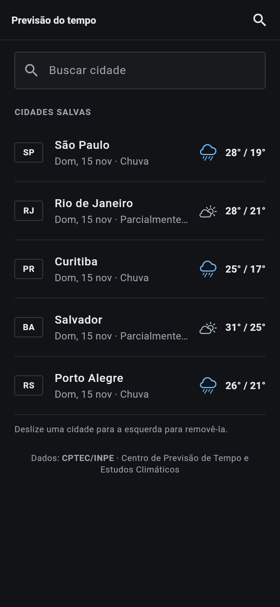 | 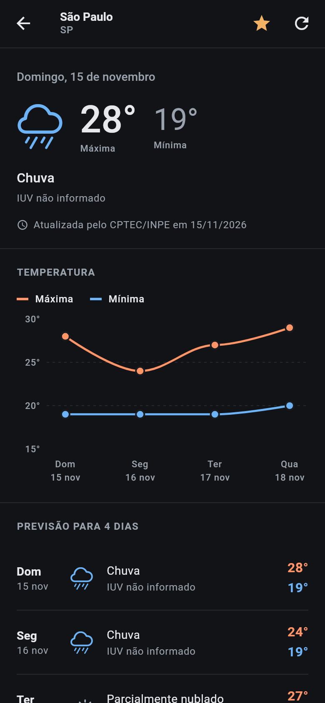 |

**11. Tablet / paisagem** – previsão e gráfico lado a lado.

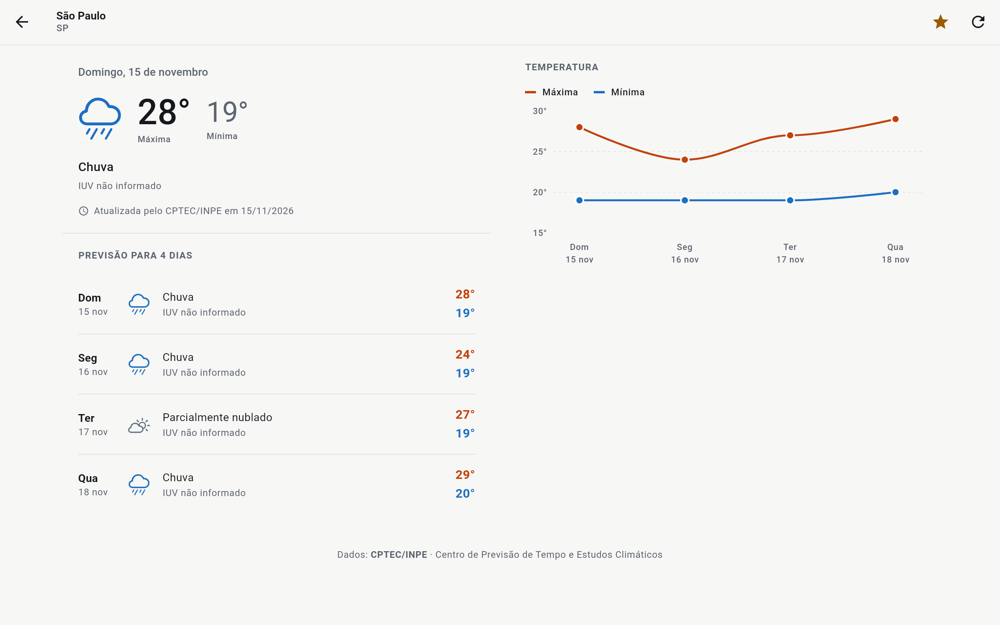

## Como executar

Pré-requisitos: [Flutter](https://docs.flutter.dev/get-started/install) 3.47 ou superior
(Dart 3.13) e um emulador ou aparelho Android/iOS.

```bash
git clone https://github.com/FelipePacheco30/atividade-2-disp-moveis.git
cd atividade-2-disp-moveis
flutter pub get
flutter run
```

O app precisa de internet para consultar o CPTEC/INPE. A permissão `INTERNET` já está
declarada no `AndroidManifest.xml` principal, então o build de release também funciona:

```bash
flutter build apk --release
```

> A versão web não é suportada: o serviço do CPTEC não envia cabeçalhos CORS, e o navegador
> bloqueia as requisições.

### Verificação

```bash
dart format --set-exit-if-changed lib test tool
flutter analyze
flutter test
```

Os mesmos comandos rodam no GitHub Actions a cada push e pull request
([.github/workflows/ci.yml](.github/workflows/ci.yml)).

### Capturas de tela

```bash
flutter test tool/capturas --update-goldens
```

O gerador ([tool/capturas/capturas_test.dart](tool/capturas/capturas_test.dart)) monta o app
real em tamanho de celular (390×844, densidade 2x) e de tablet (1280×800), carrega as fontes
Roboto, Material Icons e Cupertino Icons e percorre cada fluxo com o CPTEC simulado pelas
respostas gravadas em `test/fixtures`. As imagens são gravadas em `docs/capturas`. Ele fica
fora de `test/` porque a renderização de fontes muda entre sistemas, e um teste de imagem
falharia na CI sem que o app tivesse mudado.

## Bibliotecas utilizadas

| Biblioteca | Versão | Uso |
| --- | --- | --- |
| [http](https://pub.dev/packages/http) | 1.6.0 | Requisições ao serviço do CPTEC; `MockClient` nos testes. |
| [xml](https://pub.dev/packages/xml) | 7.1.0 | Leitura das respostas XML. |
| [shared_preferences](https://pub.dev/packages/shared_preferences) | 2.5.6 | Persistência local (API `SharedPreferencesWithCache`). |
| [fl_chart](https://pub.dev/packages/fl_chart) | 1.3.1 | Gráfico de temperatura. |
| [intl](https://pub.dev/packages/intl) | 0.20.3 | Datas em português ("Domingo, 15 de novembro"). |
| flutter_localizations | SDK | Textos dos componentes do Material em pt-BR. |
| [cupertino_icons](https://pub.dev/packages/cupertino_icons) | 1.0.9 | Ícones de condição do tempo (nuvem com chuva, sol entre nuvens etc.). |
| [flutter_lints](https://pub.dev/packages/flutter_lints) | 6.0.0 | Regras de análise estática (dev). |
| [shared_preferences_platform_interface](https://pub.dev/packages/shared_preferences_platform_interface) | 2.4.2 | Armazenamento em memória nos testes (dev). |

## Persistência local

Os dados ficam no `SharedPreferences` do aparelho, acessado pela API
`SharedPreferencesWithCache`: as leituras são síncronas a partir de um cache carregado na
abertura do app e as gravações são assíncronas. Toda a leitura e escrita passa por
[`ArmazenamentoLocal`](lib/data/armazenamento_local.dart). São duas chaves, ambas com JSON:

| Chave | Conteúdo | Quando muda |
| --- | --- | --- |
| `cidades_salvas` | Lista de cidades (`id`, `nome`, `uf`) na ordem da tela inicial. | Ao salvar ou remover uma cidade (estrela na previsão, deslizar na tela inicial, desfazer). |
| `previsoes` | Mapa `id da cidade → { salvaEm, previsao }` com a última previsão obtida de cada cidade consultada. | A cada consulta bem-sucedida que retorna dias. São mantidas as 20 mais recentes. |

Exemplo do conteúdo de `previsoes`:

```json
{
  "244": {
    "salvaEm": "2026-11-15T09:41:00.000",
    "previsao": {
      "atualizadaEm": "2026-11-15T00:00:00.000",
      "dias": [
        { "data": "2026-11-15T00:00:00.000", "condicao": "c", "minima": 19, "maxima": 28, "indiceUv": null }
      ]
    }
  }
}
```

Como os dados são usados:

- **Tela inicial**: lista as cidades salvas e, para cada uma, o primeiro dia da última
  previsão guardada, sem nova requisição.
- **Sem conexão**: se a consulta ao CPTEC falhar e houver previsão guardada para a cidade,
  o [`RepositorioPrevisao`](lib/data/repositorio_previsao.dart) devolve essa cópia junto com
  a falha, e a tela mostra um aviso com o horário em que ela foi salva.
- **Dados corrompidos**: JSON inválido ou em formato inesperado é ignorado (lista vazia ou
  previsão ausente), sem derrubar o app.

O `SharedPreferences` foi escolhido em vez de SQLite porque são poucos registros, sempre
lidos inteiros e sem consultas. Um banco relacional acrescentaria tabelas, migrações e uma
dependência nativa sem ganho para esse volume.

## Serviço do CPTEC/INPE

Documentação oficial: <https://servicos.cptec.inpe.br/XML/>

| Consulta | Endereço | Campos usados |
| --- | --- | --- |
| Localidades | `https://servicos.cptec.inpe.br/XML/listaCidades?city={nome}` | `cidade/nome`, `cidade/uf`, `cidade/id` |
| Previsão de 4 dias | `https://servicos.cptec.inpe.br/XML/cidade/{id}/previsao.xml` | `atualizacao`, `previsao/dia`, `previsao/tempo`, `previsao/maxima`, `previsao/minima`, `previsao/iuv` |

Comportamentos do serviço que o app trata:

- As respostas vêm em **ISO-8859-1**. O `http` decodifica pelo charset do `Content-Type`, e
  os testes usam as respostas gravadas byte a byte para garantir os acentos.
- Para um **código inexistente** o serviço responde `200` com todos os campos iguais a
  `null`. O leitor descarta esses dias e o app mostra "Previsão indisponível".
- O campo **`iuv` vem `0.0`** nas consultas atuais, inclusive para códigos inexistentes. Como
  o índice máximo diário nunca é zero no Brasil, `0.0` é tratado como "não informado". Valores
  positivos são exibidos com a faixa (baixo, moderado, alto, muito alto, extremo).
- A **busca vazia** devolve todas as localidades; por isso o app só busca a partir de 3 letras.
- O serviço limita as requisições (`x-ratelimit-limit: 150`). A pausa na digitação evita uma
  consulta por tecla, e o status `429` é tratado como serviço indisponível.
- Endereços `http://` são redirecionados para `https://`; o app usa `https` direto.

## Estrutura do projeto

```
lib/
├── main.dart                         inicializa datas pt-BR, abre o armazenamento e cria as dependências
├── app.dart                          MaterialApp: tema claro/escuro, localização pt-BR, tela inicial
├── core/
│   ├── formatos.dart                 datas, temperaturas e IUV formatados para exibição
│   └── tema.dart                     esquema de cores, componentes e cores de máxima/mínima
├── models/
│   ├── cidade.dart                   localidade (id, nome, UF) e conversão JSON
│   ├── condicao_tempo.dart           as 40 siglas do CPTEC, descrições e grupos visuais
│   └── previsao.dart                 previsão, dia da previsão e faixas do IUV
├── data/
│   ├── cliente_cptec.dart            requisições HTTP, tempo limite e conversão de erros
│   ├── leitor_xml_cptec.dart         XML → modelos, tolerante a campos ausentes
│   ├── falhas.dart                   falhas tipadas com mensagens para o usuário
│   ├── armazenamento_local.dart      SharedPreferences: cidades salvas e previsões
│   └── repositorio_previsao.dart     serviço + armazenamento + previsão salva quando offline
├── controllers/
│   ├── controlador_busca.dart        estado da busca, pausa na digitação, respostas fora de ordem
│   ├── controlador_previsao.dart     estado da previsão de uma cidade e atualização
│   └── cidades_salvas.dart           lista de cidades salvas compartilhada entre telas
└── presentation/
    ├── screens/
    │   ├── tela_inicial.dart         cidades salvas e acesso à busca
    │   ├── tela_busca.dart           pesquisa e resultados
    │   └── tela_previsao.dart        previsão, gráfico, atualização e estados de erro
    └── widgets/
        ├── aviso.dart                faixa de dados desatualizados
        ├── fonte_dos_dados.dart      identificação do CPTEC/INPE
        ├── grafico_temperatura.dart  gráfico de máximas e mínimas
        ├── icone_condicao.dart       ícone e cor por grupo de condição
        ├── linha_dia.dart            um dia da previsão
        ├── mensagem_estado.dart      estados vazios e de erro
        └── sigla_uf.dart             caixa com a UF

test/
├── fixtures/                         respostas reais do CPTEC (ISO-8859-1)
├── support/                          serviço simulado, armazenamento em memória e montagem do app
├── models/  data/  controllers/      testes de unidade por camada
└── presentation/                     testes de widget do fluxo e dos estados

tool/capturas/                        gerador das capturas de tela
docs/
├── arquitetura.md                    camadas, fluxo de dados e decisões
└── capturas/                         imagens usadas neste README
```

As dependências apontam sempre para dentro: telas usam controladores, controladores usam o
repositório, e o repositório usa o cliente e o armazenamento. Modelos e a camada `data` não
importam Flutter, apenas Dart puro (com exceção do `shared_preferences`).

## Testes

```bash
flutter test
```

65 testes, todos sem acesso à rede: o serviço é simulado com `MockClient` e respostas reais
do CPTEC gravadas em [test/fixtures](test/fixtures).

| Arquivo | O que verifica |
| --- | --- |
| `models/condicao_tempo_test.dart` | Todas as siglas documentadas, sigla ausente, `"null"` e desconhecida. |
| `models/previsao_test.dart` | Conversão JSON com campos ausentes e faixas do IUV. |
| `data/leitor_xml_cptec_test.dart` | Leitura de cidades e previsão, acentos, IUV `0.0`, código inexistente, campos faltando, XML malformado, HTML e raiz inesperada. |
| `data/cliente_cptec_test.dart` | URLs e parâmetros, termo vazio, falta de conexão, TLS, tempo esgotado, 5xx, 429, status inesperado e corpo inválido. |
| `data/armazenamento_local_test.dart` | Gravação e leitura, ordem das cidades, limite de previsões e dados corrompidos. |
| `data/repositorio_previsao_test.dart` | Guarda a previsão, usa a cópia quando o serviço falha e não guarda previsão vazia. |
| `controllers/*_test.dart` | Pausa na digitação, mínimo de letras, resposta antiga descartada, estado de carregamento, falha mantendo dados, desfazer remoção. |
| `presentation/fluxo_principal_test.dart` | Buscar → abrir previsão → salvar → ver na tela inicial; remover e desfazer; busca sem resultado. |
| `presentation/estados_da_previsao_test.dart` | Carregando, erro com nova tentativa, serviço indisponível, previsão salva offline, previsão vazia, campos ausentes, atualizar e falha ao atualizar. |

## Decisões de projeto

- **Sem pacote de gerência de estado.** Cada tela tem um `ChangeNotifier` próprio e as
  dependências são passadas pelo construtor. Para três telas, `provider`/`bloc` acrescentariam
  conceitos sem resolver nenhum problema que o app tenha.
- **Falhas tipadas em vez de exceções genéricas.** `FalhaConexao`, `ServicoIndisponivel` e
  `RespostaInvalida` são uma `sealed class`; as telas exibem a mensagem e escolhem o ícone
  sem conhecer detalhes de HTTP.
- **Leitura tolerante do XML.** Um campo ruim afeta só aquele valor. O dia só é descartado se
  não tiver nenhuma informação útil, como acontece na resposta para códigos inexistentes.
- **Previsão salva como alternativa offline.** Quem já consultou uma cidade continua vendo a
  previsão sem internet, com aviso claro de que pode estar desatualizada.
- **Busca enquanto digita, com proteção.** Pausa de 400 ms, mínimo de 3 letras e descarte
  de respostas de termos antigos, para não sobrecarregar o serviço nem mostrar resultados
  trocados.
- **Interface sóbria.** Paleta neutra, cantos de 4 px, divisores em vez de cartões com sombra
  e cor reservada ao que tem significado (máxima, mínima, condição e avisos).
- **Código em português.** Segue o padrão das atividades anteriores da disciplina e o
  vocabulário do próprio serviço (`previsao`, `minima`, `atualizacao`).

## Processo de desenvolvimento

- **Branches e pull requests**: a `main` recebeu apenas a configuração inicial. Cada etapa foi
  feita em uma branch e integrada por pull request com merge commit, preservando os commits:
  [#1 camada de dados](https://github.com/FelipePacheco30/atividade-2-disp-moveis/pull/1),
  [#2 interface](https://github.com/FelipePacheco30/atividade-2-disp-moveis/pull/2) e
  [#3 documentação](https://github.com/FelipePacheco30/atividade-2-disp-moveis/pull/3).
- **Commits** no padrão [Conventional Commits](https://www.conventionalcommits.org/pt-br/)
  (`feat`, `test`, `docs`, `build`, `ci`, `chore`), cada um com uma mudança que compila e passa
  nos testes.
- **CI** no GitHub Actions verifica formatação, análise estática e testes em todo push e
  pull request.
- **Análise estática** com `flutter_lints` e regras extras (`strict-casts`,
  `strict-raw-types`, `avoid_dynamic_calls`, `unawaited_futures`, entre outras).
