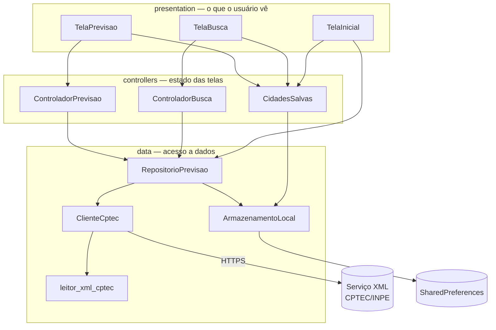
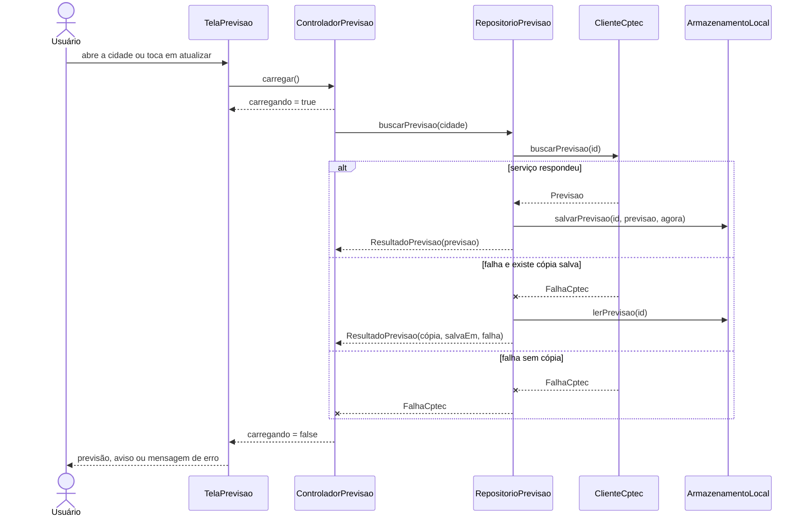

# Arquitetura

Este documento explica como o app está organizado, como os dados circulam entre as camadas
e como cada tipo de falha chega ao usuário. A visão geral, as instruções de execução e as
capturas de tela estão no [README](../README.md).

## Camadas

| Camada | Responsabilidade | Conhece Flutter? |
| --- | --- | --- |
| `models` | Dados do domínio (`Cidade`, `Previsao`, `PrevisaoDia`, `CondicaoTempo`, `NivelUv`) e conversão JSON. | Não |
| `data` | Falar com o CPTEC, interpretar o XML, persistir no aparelho e decidir quando usar a cópia salva. | Não (exceto o plugin `shared_preferences`) |
| `controllers` | Estado de cada tela (`ChangeNotifier`): carregando, resultado, falha. Não sabem desenhar nada. | Só `foundation` |
| `presentation` | Telas e componentes visuais. Leem o estado dos controladores e repassam as ações do usuário. | Sim |
| `core` | Tema e formatação de textos, usados pela apresentação. | Sim |

As dependências são criadas uma vez em [`main.dart`](../lib/main.dart) e passadas pelo
construtor, de tela em tela. Assim fica explícito o que cada tela usa, e os testes montam o app
com um serviço simulado e um armazenamento em memória sem nenhuma configuração global.

## Fluxo de uma consulta de previsão

Se uma atualização falhar quando já existe previsão na tela, o `ControladorPrevisao` mantém o
resultado anterior e expõe a falha, que aparece como aviso no topo em vez de apagar o conteúdo.

## Fluxo da busca

1. Cada tecla chama `ControladorBusca.alterarTermo`.
2. Com menos de 3 letras, o estado volta à instrução inicial e nada é consultado.
3. Caso contrário, um `Timer` de 400 ms é reiniciado; a consulta só acontece quando o usuário
   para de digitar (ou imediatamente ao confirmar no teclado).
4. Cada consulta recebe um número. Ao responder, se não for mais a consulta atual, a
   resposta é descartada. Isso evita que o resultado de "Rio" apareça depois de o usuário já ter
   digitado "Rio Claro".

## Tratamento de falhas

O [`ClienteCptec`](../lib/data/cliente_cptec.dart) converte qualquer problema técnico em uma
das três falhas de [`falhas.dart`](../lib/data/falhas.dart), cada uma com mensagem pronta para
o usuário:

| Situação | Detectada por | Falha |
| --- | --- | --- |
| Sem internet, DNS, conexão recusada | `http.ClientException` | `FalhaConexao` |
| Erro de TLS ou socket | `IOException` | `FalhaConexao` |
| Serviço não respondeu em 15 s | `TimeoutException` | `ServicoIndisponivel` |
| Erro do servidor (5xx) | status HTTP | `ServicoIndisponivel` |
| Limite de requisições (429) | status HTTP | `ServicoIndisponivel` |
| Outro status diferente de 200 | status HTTP | `RespostaInvalida` |
| Corpo que não é XML ou com raiz inesperada | `XmlException` / nome da raiz | `RespostaInvalida` |

Situações que **não** são falhas, porque o serviço respondeu corretamente:

| Situação | Resultado |
| --- | --- |
| Busca sem localidades | Lista vazia → "Nenhuma cidade encontrada". |
| Código sem previsão (campos `null`) | `Previsao` sem dias → "Previsão indisponível". |
| Campo ausente, vazio, `null` ou não numérico | Valor nulo → "—" ou "não informado". |
| Sigla de condição desconhecida | Mantém a sigla, descrição "Não definido", ícone neutro. |
| IUV `0.0` | Tratado como não informado. |

Na interface, `FalhaConexao` usa o ícone de Wi-Fi desligado e as demais o de nuvem riscada.
Todas as telas de erro oferecem "Tentar novamente".

## Persistência

[`ArmazenamentoLocal`](../lib/data/armazenamento_local.dart) é o único ponto que lê ou grava no
`SharedPreferences`. O formato das chaves e os motivos da escolha estão na seção
[Persistência local do README](../README.md#persistência-local).

Dois cuidados na implementação:

- **Leitura defensiva**: JSON inválido ou com tipos inesperados resulta em lista vazia ou
  previsão ausente; o erro nunca chega à interface.
- **Limite de tamanho**: ao salvar uma previsão, as entradas são ordenadas pela data em que
  foram salvas e apenas as 20 mais recentes permanecem.

## Interface

- **Tema** ([`tema.dart`](../lib/core/tema.dart)): esquema de cores definido manualmente para
  claro e escuro, sem gerar a paleta a partir de uma cor semente, para manter fundos neutros. As
  cores de máxima e mínima ficam em uma `ThemeExtension` (`CoresTemperatura`), usada pelo
  gráfico e pelas linhas de cada dia.
- **Ícones** ([`icone_condicao.dart`](../lib/presentation/widgets/icone_condicao.dart)): as 40
  siglas são agrupadas em 11 grupos (`GrupoTempo`), e cada grupo tem um ícone e uma cor
  para os temas claro e escuro. O agrupamento fica no modelo; o ícone, na apresentação.
- **Responsividade**: a tela de previsão passa para duas colunas a partir de 840 dp de
  largura. A tela inicial limita o conteúdo a 720 dp para não esticar a lista em tablets.
- **Acessibilidade**: ícones de condição têm `semanticLabel` com a descrição, as temperaturas
  de cada dia são lidas como "Máxima 28°, mínima 19°" e as ações da barra têm tooltip.
- **Gráfico** ([`grafico_temperatura.dart`](../lib/presentation/widgets/grafico_temperatura.dart)):
  o eixo vertical se ajusta aos valores com intervalos de 2° ou 5°. Um dia sem temperatura
  interrompe a linha (`FlSpot.nullSpot`) em vez de ligar pontos com um valor inventado.

## Testes

A estratégia acompanha as camadas:

- **Unidade** para modelos, leitor XML, cliente (com `MockClient`), armazenamento (com
  `SharedPreferences` em memória), repositório e controladores.
- **Widget** para o app inteiro, montado por
  [`test/support/app_de_teste.dart`](../test/support/app_de_teste.dart) com o serviço simulado.
- **Fixtures reais**: os XML em `test/fixtures` foram baixados do CPTEC em 15/11/2026 e
  mantidos em ISO-8859-1, como o serviço envia.

O gerador de capturas em `tool/capturas` usa a mesma montagem do app, então as imagens do README
mostram exatamente o que os testes exercitam.
